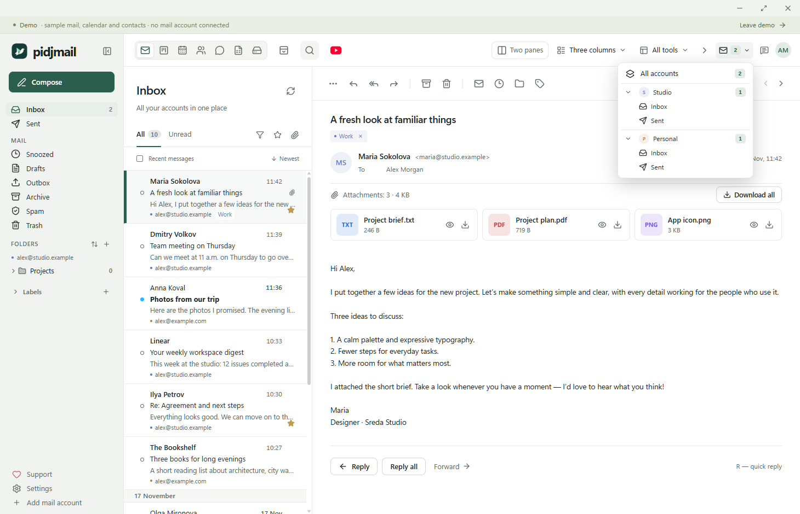

# Pidjmail

English · [Русский](README.ru.md)

Mail, calendar, contacts, tasks and work chats in one Windows app. Created by **EmDiSoftware**.

[Download the latest Windows x64 version](https://github.com/AdamAnomatik/Pidjmail-Releases/releases/latest) · [Full bilingual changelog](CHANGELOG.md)

## New in 0.7.2

- Chats you are not viewing are unloaded from memory after a minute. You stay signed in, and a chat loads again when you open it. For live chat notifications, turn on Settings → Memory → Keep chats loaded.
- YouTube and cloud drives in the background also free memory after a minute. Mail data takes less memory.
- Messages and attachments opened one after another open faster: the mail server connection is reused.
- Scanned drawings in PDFs no longer shimmer when reduced, and images are no longer cut off at the bottom when zoomed.
- Saving an attachment or an archive shows progress in the corner and a Show in folder button.
- The Memory section shows what the main process holds and names every process by what it shows.

## Features

- Multiple IMAP/SMTP accounts, a unified inbox, folders, search and read receipts.
- Drafts, replies, forwarding, image signatures and scheduled sending.
- PDF, image, spreadsheet and Word previews; individual downloads or one ZIP.
- Calendar, contacts, task boards and two configurable workspace panes.
- VK WorkSpace, Google Chat, Telegram, WhatsApp, MAX and cloud-drive panels.
- Optional Pidjmail AI assistant, running locally or through a service you choose.
- Russian and English interface, with light and dark themes.

## Install and update

Download the `.exe` installer from the [latest release](https://github.com/AdamAnomatik/Pidjmail-Releases/releases/latest). Quit Pidjmail from its tray menu before updating, then install to the same folder. There is no need to remove your mail account.

The installer is unsigned, so Windows may show a warning. Automatic updates are not yet available.

Back up the complete profile folder, its key and your selected mail folders. A normal uninstall keeps the profile.

## Things to know

- Mail uses IMAP/SMTP with an app password; mail OAuth is not supported yet. Calendar and contacts are local.
- Web chats, drives and YouTube depend on provider and network availability; sign-in or calls may require a browser. Task reminders require the app to remain running, including in the tray.
- New outgoing attachments: up to 30 files and 100 MB per message; your mail server also sets its own limit. Signatures allow up to 10 images of 5 MB each, 20 MB combined. Large incoming files can still be downloaded separately.
- The local assistant requires an initial download of about 2.3 GB and around 8 GB of memory. Cloud requests are billed separately and send data to your chosen service with your consent.

[Help and bug reports](SUPPORT.md) · [Privacy](PRIVACY.md) · [Security](SECURITY.md) · [MCP setup, Russian](MCP.ru.md) · [Google Sheets setup, Russian](GOOGLE-SHEETS.ru.md)
