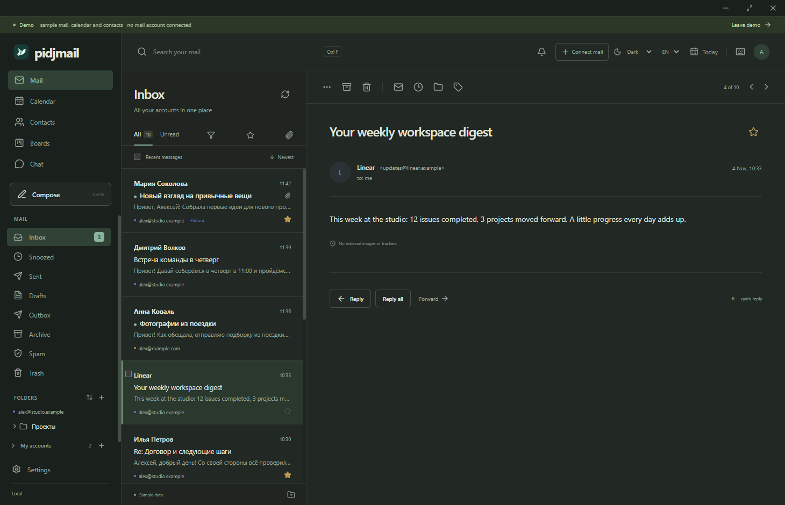

# Pidjmail

[](https://github.com/AdamAnomatik/Pidjmail-Releases/releases/latest)
[](https://github.com/AdamAnomatik/Pidjmail-Releases/releases)
[](https://github.com/AdamAnomatik/Pidjmail-Releases/releases/latest)

**English** · [Русский](README.ru.md)

<p align="center">
  
</p>

**Pidjmail** is a Windows email client with mail, a calendar, contacts and task boards in a calm, readable workspace.

## Features

- Multiple IMAP/SMTP accounts and a unified inbox, server folders and incoming mail updates through IMAP IDLE.
- Replies, forwarding, drafts, scheduled sending and cancellation before SMTP transmission.
- Incoming-mail filters, sender grouping, Ctrl+F search and restoration from Trash.
- In-memory previews for text, images and PDF, with an explicit **Save As** action.
- Local calendar, contacts and kanban boards; turn an email into an event, task or contact.
- Separate Mail / Calendar / Boards notifications, tray reminders, profile pictures and account signatures.
- Russian and English interface; light, dark and system themes.
- OpenAI / Claude in a right-side chat panel: web app sign-in or your own API key and model. Embedded sign-in depends on the service; a browser fallback is available.
- Encrypted local profiles, with separate real-mail and demo workspaces.

## Download

The latest release is available in **Releases**. Version 0.2.1 is an early working release.

➡️ **[Download the latest version of Pidjmail](https://github.com/AdamAnomatik/Pidjmail-Releases/releases/latest)**

### Files

- `Pidjmail-Setup-x.y.z-x64.exe` — application installer.
- `Pidjmail-Setup-x.y.z-x64.sha256.txt` — SHA-256 checksum for verifying the downloaded file.

## System requirements

- 64-bit Windows. This release was tested on Windows 11 x64.
- Internet access and a supported IMAP/SMTP account for real mail.
- Node.js is not required.

## Installation

1. Download the latest `Pidjmail-Setup-x.y.z-x64.exe`.
2. Run the installer and choose an installation folder. Installation is for the current Windows user.
3. Choose whether to create a desktop shortcut, then open Pidjmail from the Start menu or desktop. Minimizing keeps it running in the tray; Quit closes it.
4. Connect an account using an app password, or choose **Take a look first** to explore sample data.

The application and installer are currently **unsigned**. Provider-specific setup instructions are available in Settings.

## Updating

Close Pidjmail and run the new installer. Automatic updating is not available yet. Back up your profile before changing versions. A same-version reinstall has been tested; migration between future releases requires separate validation. Normal uninstall preserves your profile.

## Data location

After IMAP/SMTP verification, choose a mail data folder and whether to download attachments. Downloading continues in the background. Change the folder under Settings → Data storage. Preview/manual saving is the default; automatic attachment saving uses an explicitly chosen folder.

The encrypted application profile defaults to `Pidjmail Data` beside the installation directory, on the same drive. Choosing another drive for the first mailbox also moves the profile. `%APPDATA%/Pidjmail-location.json` contains only the path pointer. An unavailable drive causes an error, never a silent fallback to C:. A legacy encrypted profile is preserved during migration.

Profiles, mail credentials and optional API keys are encrypted using Windows user protection. Mail connects directly to your provider. Optional AI API requests go to the selected provider after your action. An enabled AI web app loads the official website in an isolated session. See [PRIVACY.md](PRIVACY.md).

## Current limitations

The calendar, contacts and boards are local. Reminders and scheduled delivery require the application to be running. The cache is limited to 100 messages per folder, and search uses the cache. OAuth, cloud calendar/contact synchronization and human chat are not available yet. Read receipts depend on the recipient's client; transmitted SMTP mail cannot be universally recalled. Office attachments do not have a built-in preview.

Real provider accounts and paid AI requests still require validation. Local TLS protocol tests and desktop installation tests have passed. This public repository contains distribution documentation and release assets; source code is maintained privately.

## Verify SHA-256

You can verify the installer checksum in PowerShell:

```powershell
Get-FileHash .\Pidjmail-Setup-0.2.1-x64.exe -Algorithm SHA256
```

The result must match the value published in `Pidjmail-Setup-0.2.1-x64.sha256.txt`.

## Report an issue

➡️ **[Open an issue](https://github.com/AdamAnomatik/Pidjmail-Releases/issues/new/choose)**

Please include your Pidjmail and Windows versions, reproduction steps, and a screenshot with private information removed. Never include passwords, API keys, profile files or private email content. See [SUPPORT.md](SUPPORT.md), [SECURITY.md](SECURITY.md) and [CHANGELOG.md](CHANGELOG.md).


