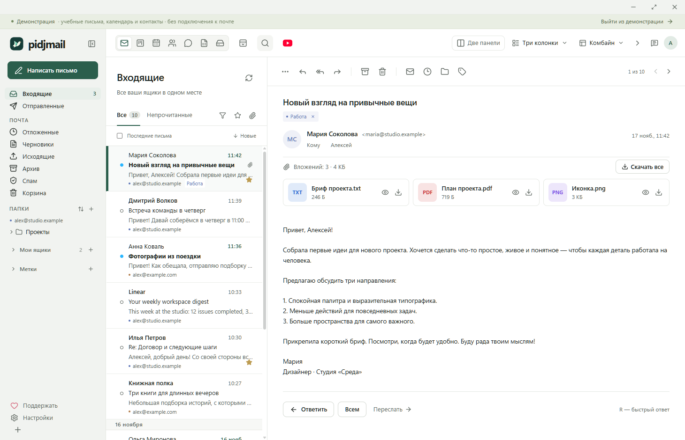

# Pidjmail

[English](README.en.md) · Русский

Почта, календарь, контакты, задачи и рабочие чаты в одном приложении для Windows. Разработчик — **EmDiSoftware**.

[Скачать последнюю версию для Windows x64](https://github.com/AdamAnomatik/Pidjmail-Releases/releases/latest) · [Все изменения на русском и английском](CHANGELOG.md)

## Новое в 0.7.2

- Чаты, которые сейчас не открыты, через минуту выгружаются из памяти. Вход сохраняется, чат загрузится заново при открытии. Чтобы уведомления чатов приходили постоянно, включите «Настройки → Память → Держать чаты загруженными».
- YouTube и облачные диски в фоне тоже освобождают память через минуту. Данные писем занимают меньше памяти.
- Письма и вложения, открытые одно за другим, открываются быстрее: соединение с почтовым сервером переиспользуется.
- Сканы чертежей в PDF больше не рябят при уменьшении, а изображения не обрезаются снизу при увеличении.
- При скачивании вложения или архива в углу окна видны ход загрузки и кнопка «Показать в папке».
- В разделе «Память» видно, что занимает основной процесс, и каждый процесс подписан по содержимому.

## Возможности

- Несколько почтовых ящиков IMAP/SMTP, общий список, папки, поиск и подтверждения прочтения.
- Черновики, ответы, пересылка, подписи с изображениями и отложенная отправка.
- Просмотр PDF, изображений, таблиц и Word; скачивание файлов по отдельности или одним ZIP.
- Календарь, контакты, доски задач; две настраиваемые рабочие панели.
- VK WorkSpace, Google Chat, Telegram, WhatsApp, MAX и облачные диски в отдельных панелях.
- Необязательный помощник Pidjmail AI: локально или через выбранный вами сервис.
- Русский и английский интерфейс, светлая и тёмная темы.

## Установка и обновление

Скачайте установщик `.exe` из [последнего выпуска](https://github.com/AdamAnomatik/Pidjmail-Releases/releases/latest). Перед обновлением полностью выйдите из Pidjmail через меню значка в трее и установите программу в прежнюю папку. Отключать почтовый ящик не требуется.

Установщик не имеет цифровой подписи: Windows может показать предупреждение. Автоматического обновления пока нет.

Сохраняйте полную резервную копию папки профиля вместе с ключом и выбранными папками почты. Обычное удаление программы сохраняет профиль.

## Что учитывать

- Почта подключается по IMAP/SMTP с паролем приложения; почтовый OAuth пока не поддерживается. Календарь и контакты локальные.
- Веб-чаты, диски и YouTube зависят от доступности сети и правил сервиса: иногда вход или звонки нужно открыть в браузере. Напоминания работают, пока приложение запущено, включая трей.
- Для новых исходящих вложений: до 30 файлов и 100 МБ на письмо; итоговый размер также ограничивает ваш почтовый сервер. В подписи — до 10 изображений по 5 МБ, не более 20 МБ вместе. Скачивание больших входящих файлов доступно отдельно.
- Локальному помощнику нужны разовая загрузка около 2,3 ГБ и примерно 8 ГБ памяти. Облачные запросы оплачиваются отдельно и передают данные выбранному сервису с вашего согласия.

[Помощь и сообщения об ошибках](SUPPORT.md) · [Конфиденциальность](PRIVACY.md) · [Безопасность](SECURITY.md) · [Подключение MCP](MCP.ru.md) · [Google Таблицы](GOOGLE-SHEETS.ru.md)
