# Pidjmail

При резервном копировании сохраняйте всю папку профиля с `encryption-key.json` и `Browser/Local State`, а также выбранные папки почты. Одного `profile.enc` недостаточно. Если ключ недоступен, можно выбрать полную резервную папку или создать новый профиль отдельно; исходные файлы автоматически не удаляются.

[](https://github.com/AdamAnomatik/Pidjmail-Releases/releases/latest)
[](https://github.com/AdamAnomatik/Pidjmail-Releases/releases)
[](https://github.com/AdamAnomatik/Pidjmail-Releases/releases/latest)

[English](README.md) · **Русский**

<p align="center">
  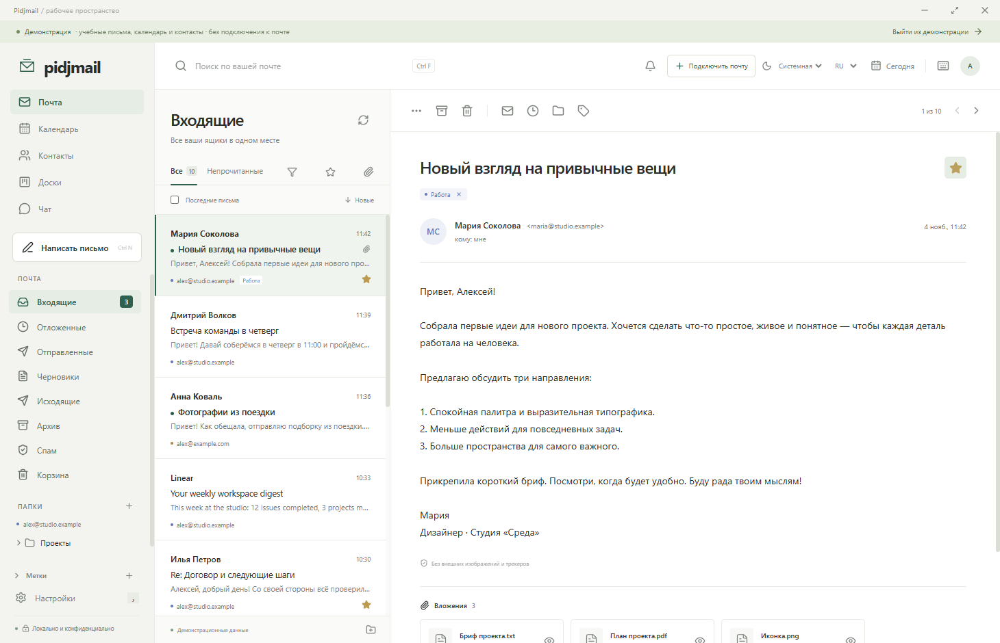
</p>

**Pidjmail** — почтовый клиент для Windows: почта, календарь, контакты и доски задач в спокойном и понятном интерфейсе.

## Возможности

В 0.2.20: вернулся вид «Три колонки»; «Ответить», «Ответить всем» и «Переслать» — в верхней панели письма; отправленное сразу видно в «Отправленных»; плашка ошибки не мигает от разового обрыва связи; можно выбрать, закрывает ли крестик программу или сворачивает её в трей; скрытые диски и чаты без уведомлений освобождают память.

В 0.2.19: облачные диски в режиме «Комбайн». Новый раздел «Диски» открывает Яндекс Диск, Google Диск, Облако Mail, OneDrive и Dropbox в их официальных веб-версиях прямо в Pidjmail: файлы можно смотреть, загружать и скачивать, в том числе во второй панели рядом с почтой или в отдельном окне. У каждого диска своя сессия, вход хранится только в зашифрованном профиле, а внутри панели открываются только сайты самого сервиса. Чтобы приложить файл с диска к письму, сначала скачайте его: прямого прикрепления пока нет.

<p align="center">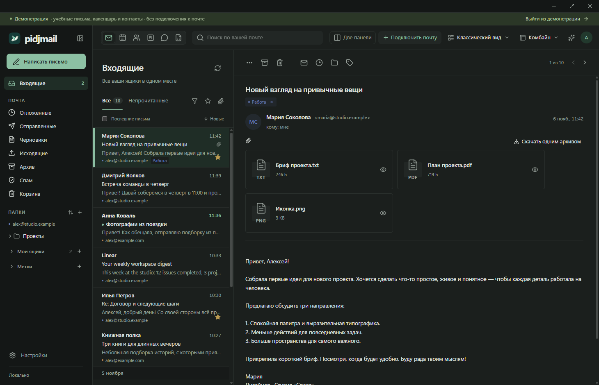</p>

<p align="center">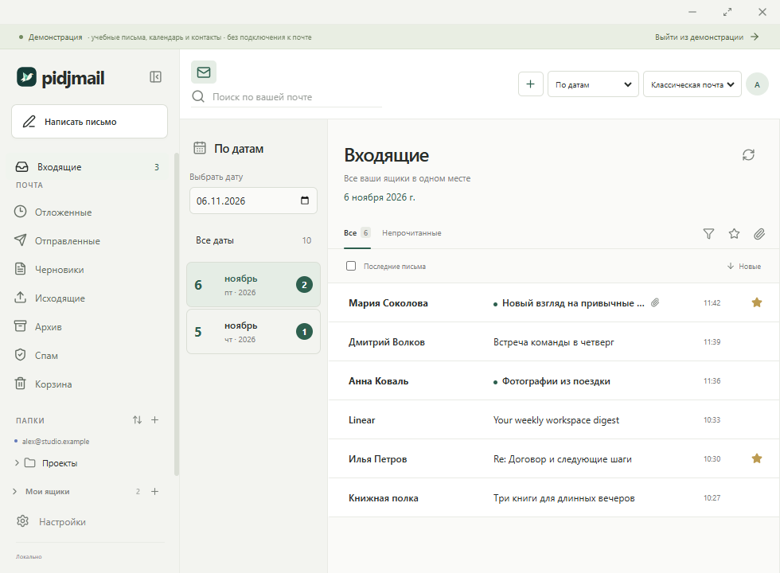</p>


Новое в 0.2.13: HTML-подписи со встроенными логотипами, вложения сверху, свёрнутая переписка, просмотр Office в памяти и скачивание вложений одним ZIP. Инкрементальная проверка почты и более лёгкое переключение разделов. Изменение размеров уведомлений в **Настройки → Звуки и напоминания → Всплывающие окна**. Ширина и высота сохраняются для всех источников, доступны настоящий предпросмотр и возврат стандартного размера.

Новое в 0.2.12: независимый выбор обоих разделов в двух панелях, с сохранением выбора. Заголовок чата — в одну строку, дополнительные действия — в меню «…» на узкой панели. **Настройки → Звуки и напоминания → Всплывающие окна**: общий угол экрана, цвет фона, время показа и предпросмотр для почты, календаря, досок и подключённых чатов. Можно выбрать стандартные окна Windows.

<p align="center">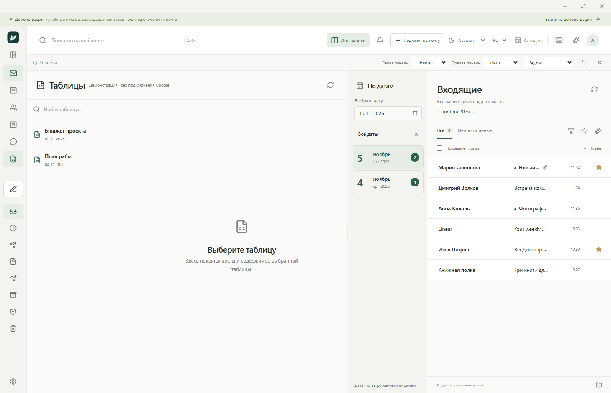</p>

<p align="center">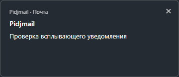</p>

Новое в 0.2.11: Google Таблицы — отдельный список и просмотр, вход через браузер и [инструкция настройки своего OAuth-клиента](GOOGLE-SHEETS.ru.md). Архив почты подгружается при просмотре без общего лимита 100 писем; старые тексты — при открытии.

<p align="center">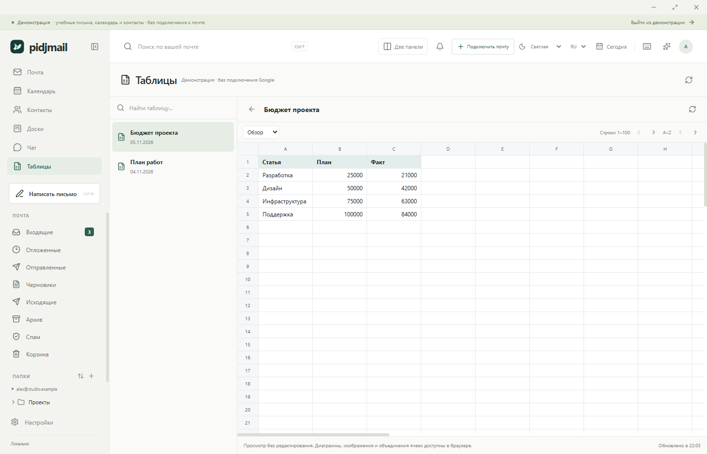</p>

Новое в 0.2.10: две панели внутри одного окна — почта, календарь, контакты или доски рядом с чатом. Нажмите «Две панели» вверху; можно менять стороны, перетаскивать границу и ставить панели друг под другом. Расположение сохраняется.

<p align="center">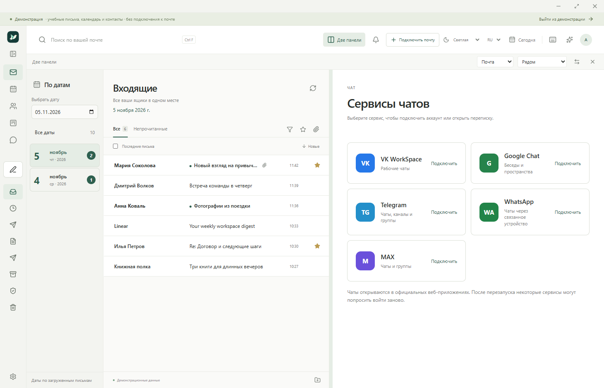</p>

В 0.2.9: отдельное окно чата рядом с почтой, возврат к последнему сервису, компактное меню, масштаб чатов, счётчики и всплывающие уведомления. Подсказки получателей ищут контакты и адресатов загруженных исходящих; проверка входящих идёт отдельно от длительного обхода папок.

- Рабочее окно по датам, с чтением справа или списком в стиле Mail.ru; сохраняемые ширины панелей и сворачивание меню.
- Галочки подтверждённых MDN в отправленных; локальный MCP с подтверждением отправки/корзины. [Подключение MCP](MCP.ru.md).

- Несколько ящиков IMAP/SMTP, общий список, серверные папки и ускоренное получение входящих через IMAP IDLE.
- Ответы, пересылка, черновики, отложенная отправка и отмена до передачи SMTP.
- Фильтры входящей почты, группировка по отправителю, поиск Ctrl+F, восстановление из корзины.
- Просмотр текста, изображений и PDF в памяти, отдельное **«Сохранить как…»**.
- Локальные календарь, контакты и канбан-доски; создание события, задачи и контакта из письма.
- Отдельные уведомления почты, календаря и досок; напоминания в трее, аватар и подписи.
- Русский и английский интерфейс; светлая, тёмная и системная темы.
- VK WorkSpace (отдельный мессенджер), Google Chat, Telegram, WhatsApp и MAX: выбор сервиса и переключение во вкладке «Чат», отдельные сессии.
- Помощник Pidjmail: ищет письма, читает вложения, собирает реестры и готовит черновики. Бесплатно на компьютере или через ваш аккаунт OpenRouter, OpenAI или Anthropic; отправлять и удалять письма сам не может.
- Зашифрованные локальные профили, отдельные рабочий и демонстрационный режимы.

<p align="center">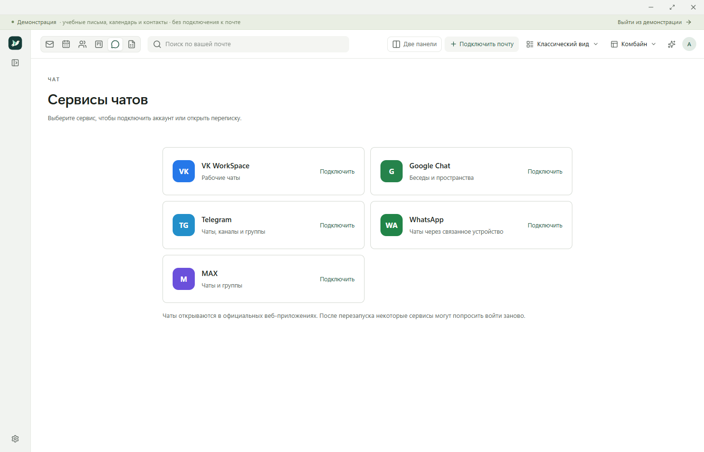</p>

<p align="center">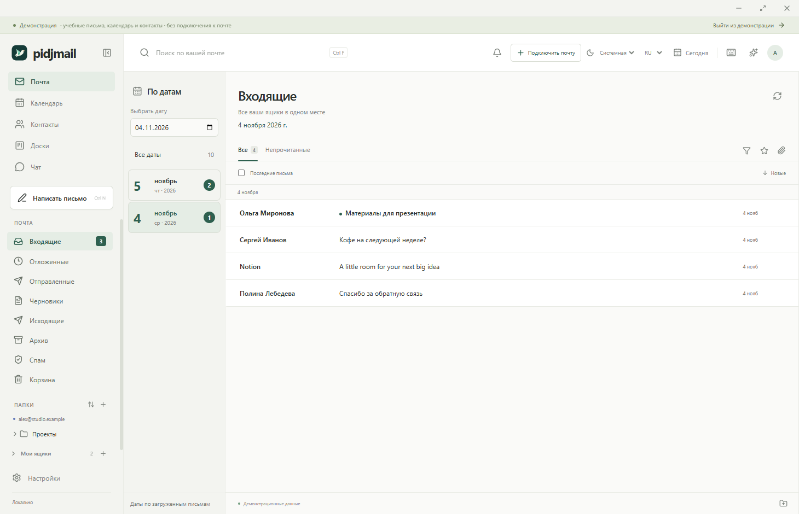</p>

<p align="center">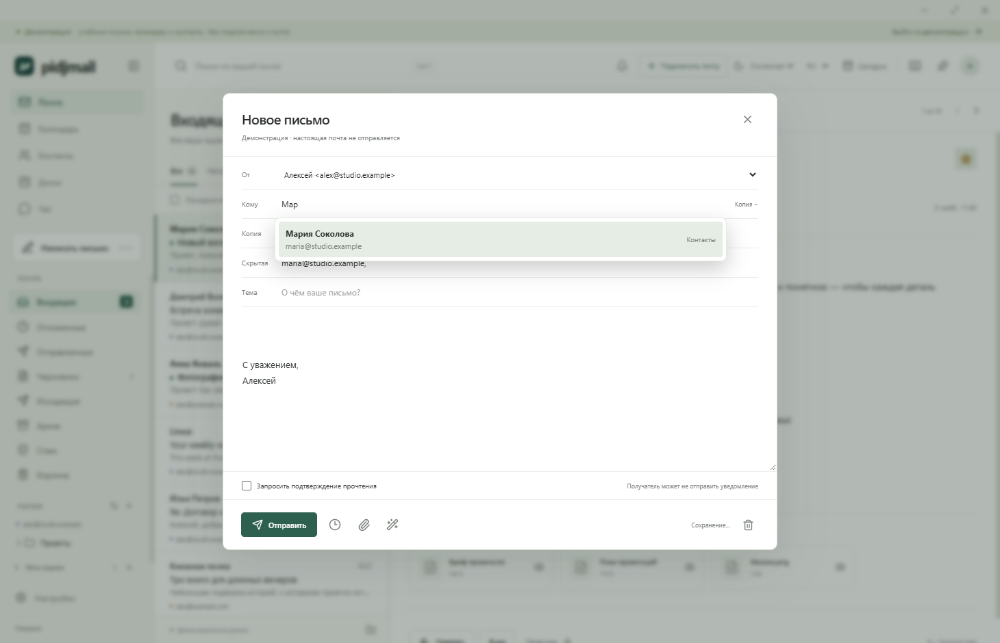</p>

## Скачать

Последняя версия доступна в разделе **Releases**. Версия 0.2.20 — ранняя рабочая сборка.

➡️ **[Скачать последнюю версию Pidjmail](https://github.com/AdamAnomatik/Pidjmail-Releases/releases/latest)**

### Что скачать

- `Pidjmail-Setup-x.y.z-x64.exe` — установщик приложения.
- `Pidjmail-Setup-x.y.z-x64.sha256.txt` — контрольная сумма SHA-256 для проверки файла.

## Системные требования

- 64-разрядная Windows. Эта версия проверена на Windows 11 x64.
- Интернет и поддерживаемая учётная запись IMAP/SMTP для настоящей почты.
- Отдельная установка Node.js не нужна.

## Установка

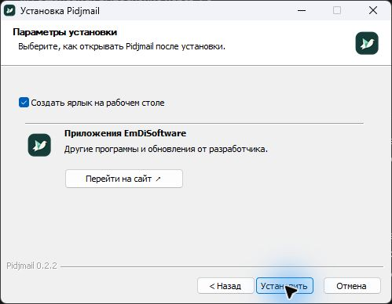

1. Скачайте последний `Pidjmail-Setup-x.y.z-x64.exe`.
2. Запустите установщик и выберите папку. Установка выполняется для текущего пользователя Windows.
3. Выберите, создавать ли ярлык на рабочем столе. Откройте Pidjmail через «Пуск» или ярлык. Сворачивание оставляет его в трее; «Выход» завершает работу.
4. Подключите ящик паролем приложения или нажмите **«Сначала посмотреть»** для демонстрации.

Приложение и установщик пока **без цифровой подписи**. Инструкции подключения провайдеров доступны в настройках.

## Обновление

Закройте Pidjmail и запустите новый установщик. Автоматического обновления пока нет. Перед сменой версии сохраните резервную копию профиля. Проверена повторная установка той же версии; миграции между будущими версиями требуют отдельной проверки. Обычное удаление приложения сохраняет профиль.

## Где хранятся данные

После проверки IMAP/SMTP выберите папку почты и загрузку с вложениями или без. Загрузка идёт в фоне. Папку можно сменить в настройках → Хранение данных. По умолчанию — просмотр и ручное сохранение; автоматическое сохранение включается отдельно с выбором папки.

Зашифрованный профиль по умолчанию находится в `Pidjmail Data` рядом с каталогом установки на том же диске. Выбор другого диска для первого ящика переносит туда и профиль. `%APPDATA%/Pidjmail-location.json` содержит только путь. Недоступный диск вызывает ошибку, без переключения на C:. При миграции прежний зашифрованный профиль сохраняется.

Профили, пароли почты и ключи помощника шифруются средствами Windows с привязкой к пользователю ОС. Почта соединяется напрямую с провайдером. Локальный помощник работает без интернета; облачный отправляет запрос выбранному вами сервису по вашей команде. Подробнее: [PRIVACY.md](PRIVACY.md).

## Уведомления

Уведомления: разрешите их в сервисе и настройках Pidjmail → Звуки и напоминания → Чаты. Кнопка проверки помогает проверить вызов баннера; Windows может блокировать показ через разрешения и «Не беспокоить». Счётчик зависит от title/веб-уведомлений сервиса, не гарантирует серверный итог. Service Worker-only уведомления отдельно не перехватываются.

## Текущие ограничения

Календарь, контакты и доски локальные. Напоминания и запланированная отправка требуют работающего приложения. История заголовков подгружается автоматически в фоне по 100 писем без общего ограничения, поиск работает по загруженному кэшу. OAuth почты и облачная синхронизация календаря/контактов ещё не реализованы. Чаты открываются через официальные веб-приложения; после перезапуска возможен повторный вход, звонки и запись голоса — в браузере. Настоящая переписка после входа пока не проверена. Уведомление о прочтении зависит от клиента получателя; универсально отозвать переданное SMTP-письмо нельзя. Таблицы показывают до 2000 строк и 100 столбцов; DOCX показывает страницы. Не все сложные элементы Office воспроизводятся, старый DOC пока не поддержан.

Реальные почтовые аккаунты и платные запросы помощника ещё требуют проверки. Локальные TLS-протоколы и установка desktop-приложения проверены. В публичном репозитории находятся описание и файлы выпусков; исходный код хранится приватно.

## Проверка SHA-256

В PowerShell:

```powershell
Get-FileHash .\Pidjmail-Setup-0.2.10-x64.exe -Algorithm SHA256
```

Полученное значение должно совпасть с файлом `Pidjmail-Setup-0.2.10-x64.sha256.txt`.

## Сообщить об ошибке

➡️ **[Создать обращение](https://github.com/AdamAnomatik/Pidjmail-Releases/issues/new/choose)**

Укажите версии Pidjmail и Windows, шаги воспроизведения и скриншот без приватных данных. Не публикуйте пароли, API-ключи, файлы профиля или личную переписку. См. [SUPPORT.md](SUPPORT.md), [SECURITY.md](SECURITY.md) и [CHANGELOG.md](CHANGELOG.md).


